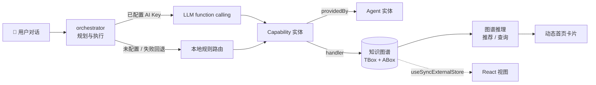

# 🏡 家庭仪表盘 · Family Dashboard

一个以 **本体（Ontology）为核心** 的家庭 AI 助手。家人、健康状况、食材、食谱、订单、旅行、任务，乃至 **Agent 与它们的能力**，
全部是同一张知识图谱里的类型化实体，通过受 Schema 约束的关系（三元组）相连。AI 对话只负责“理解意图 → 选择能力”，
真正的数据、推理与扩展都落在本体上。

> 健康饮食建议仅供参考，不能替代医生或营养师的专业意见。

## 饮食约束与推荐

- 对话支持“爸爸是素食主义者”“爸爸吃素”“爸爸吃纯素”等明确陈述。本地规则与 AI 工具均通过
  `hasAttribute` 保存单值 `饮食类型`：`vegetarian`（素食）、`vegan`（纯素）、`omnivore`（杂食）。
  疑问或含糊否定不会推断新的素食限制；明确更改饮食类型会替换旧类型。
- **普通素食**排除畜禽肉、鱼、海鲜及其制品（如肉汤、鱼露、肉源明胶），保留蛋奶；**纯素**还排除蛋、
  乳及其他动物来源（如蜂蜜）。豆腐等植物蛋白不因属于 `protein` 类被排除。
- `FoodSource` 来源实体通过 `Ingredient-derivedFrom` 关联食材；混合食材必须记录全部来源。
  内置来源清单在 `src/data/food/ingredientSources.json`；食谱辅料也经人工核对，在
  `recipeExtraSources.json` 中通过 `Recipe-extrasDerivedFrom` 标注，避免只检查主料。
  新增食材/食谱时必须补齐这些元数据与 `usesIngredient` 关系。
- AI 食材采集要求返回全部 `foodSources`，仅接受已知来源 ID。缺失、空或包含无效 ID 时不猜测来源，
  旧采集食材也不按名称或类别自动认定安全：有素食约束时暂不推荐并说明来源不完整；无约束时维持原行为。
  AI 元数据仍可能出错，需要核实，并不能保证现实产品或烹饪过程无动物配料/交叉接触。
- 兼容旧档案中明确表达饮食类型的饮食偏好/禁忌属性；启动迁移将其规范化，新类型替换相冲突的旧类型声明，
  不删除无关偏好。“不吃肉/肉类”“不能吃肉”“忌肉”作为独立肉类禁忌过滤，不推断鱼或蛋奶限制；
  “不吃荤/荤食”“忌荤”过滤肉、鱼、海鲜，均不会把纯素降级。本次不扩展其他通用忌口解析。
  素食不作为疾病或过敏保存。
- 食材先按过敏排除，再检查所有目标成员的饮食约束，排除项说明涉及成员及原因；含违禁食材的整道食谱被排除。
  指定成员只使用该成员档案；共享推荐考虑全体目标成员。原有健康/季节评分、食谱平均分和餐次筛选保留。
- 档案更新先执行，再分别补齐缺少且已启用的食材/食谱推荐，显式成员、类别和餐次参数不变。
  首页已有卡片通过图谱订阅重算，空结果也更新卡片，自动刷新不取消用户隐藏模块的选择。

验证：`npm test`（Node 内置测试运行器，使用已有 Vite 加载 JSON 模块）、`npm run lint`、`npm run build`。

---

## 🏛️ 架构亮点

### 1. 本体驱动：一套模型统一所有领域



| 层 | 文件 | 职责 |
|----|------|------|
| **TBox（Schema）** | `src/ontology/schema.js` | 声明 16 个类与 17 种关系，每种关系都带 `domain → range` 类型约束 |
| **ABox（知识图谱）** | `src/ontology/graph.js` | 轻量内存三元组存储，写入时按 Schema 校验；支持批量事务、订阅、分层持久化 |
| **种子与迁移** | `src/ontology/seed.js` | 把本地 JSON 模拟数据转换为实体 + 三元组；迁移旧版本数据 |
| **领域查询** | `src/ontology/queries.js` | 成员档案、同义词解析、概念扩展等领域 API，Agent 不直接操作三元组 |
| **Agent 层** | `src/agents/` | 路由、档案抽取、编排、能力实现、图谱推荐、LLM 客户端 |
| **视图层** | `src/components/` | 通过 `useGraph()` 订阅图谱版本号，图谱变化即刷新 UI |

### 2. Schema 即契约：写入时强校验

`KnowledgeGraph.addTriple(s, p, o)` 会依次检查：关系是否在 Schema 中定义、主语/宾语实体是否存在、
类型是否满足 `domain`/`range`、字面量关系的宾语是否为对象。任何不符合本体的数据都无法进入图谱；
从 localStorage 恢复时，已不满足当前 Schema 的旧三元组会被自动跳过。

```
FamilyMember ─hasCondition→ HealthCondition      Ingredient ─benefits / cautionFor→ HealthCondition
FamilyMember ─allergicTo──→ Allergen              Ingredient ─containsAllergen→ Allergen
FamilyMember ─hasAttribute→ Literal(开放属性)     Ingredient ─availableIn→ Season
Recipe ─usesIngredient→ Ingredient                PriceOffer ─offerOf→ Ingredient / ─soldAt→ Store
Promotion ─promotes→ Ingredient                   Order ─orderedFrom→ Store / ─orderContains→ Ingredient
Shipment ─shipmentOf→ Order                       Task ─assignedTo→ FamilyMember
HealthReminder ─reminderFor→ FamilyMember         Capability ─providedBy→ Agent
```

### 3. 关系优先，不在属性里冗余引用

实体之间的联系 **一律用关系（三元组）表达**，不在属性里保存名称或 id：

- 任务 / 健康提醒通过 `assignedTo` / `reminderFor` 指向家庭成员，无关系即表示“全家”；
- 能力只通过 `providedBy` 归属 Agent；
- 旅行清单、心愿等嵌套值对象只保存成员实体 id，显示时从图谱解析姓名。

好处：改名无需同步、删除成员会级联移除相关三元组、不会出现悬空引用。旧版本持久化的名称引用
在启动时由 `migrateLegacyKnowledge` 自动迁移为关系。

### 4. 双层知识：内置知识与用户知识分离

- **`base` 层**：由 `src/data/**/*.json` 种子生成，不持久化、不可删除（只能禁用）；
- **`user` 层**：对话中产生的家人、档案、任务、自定义能力等，持久化到 localStorage；
- **overrides**：对内置实体的修改（如禁用某个内置能力、编辑内置 Agent 配置）以补丁形式持久化。

因此升级内置数据不会覆盖用户知识，“恢复默认”也只需丢弃 user 层与补丁后重新种子。

### 5. 开放世界：对话即可扩展本体

- **开放属性**：`hasAttribute` 的宾语是字面量 `{ key, value }`，家人属性不受预设字段限制（如“血压：150/95”“最近睡眠不好”）；
- **概念自动扩展**：抽取到未知的健康状况/过敏原时，`ensureCondition` / `ensureAllergen` 会把它作为新实体加入本体；
- **同义词解析**：`HealthCondition` / `Allergen` / `Ingredient` 都带 `synonyms`，自然语言通过本体词表映射到实体。

### 6. Agent 与能力本身也是本体实体

`Agent` 和 `Capability` 是本体中的类，二者通过 `providedBy` 关联。这带来几个直接效果：

- **运行时扩展**：新增能力 = 新增一个 `Capability` 实体 + 一条 `providedBy` 三元组，无需改代码、即时生效；
- **工具自动生成**：LLM 的 function calling 工具列表直接由已启用的 `Capability` 实体生成（名称、描述、JSON Schema 参数）；
- **本体注入提示词**：系统提示词会自动列出本体类与 `domain-关系->range`，让大模型理解领域模型；
- **本地路由同源**：未配置 AI Key 时，本地路由同样基于 `Capability` 实体上的关键词与优先级打分。

### 7. 基于图谱推理的推荐

`recommender.js` 不是写死的规则表，而是沿着图谱路径推理：

```
Member ─hasCondition→ Condition ←benefits / cautionFor─ Ingredient   （加分 / 减分并给出理由）
Member ─allergicTo──→ Allergen  ←containsAllergen──── Ingredient   （直接排除并说明原因）
Ingredient ─availableIn→ Season（当前月份）                           （当季优先）
Recipe ─usesIngredient→ Ingredient                                    （食谱评分 = 食材评分聚合）
```

每条推荐都能回溯到具体的成员与关系，可解释性天然具备。新增一种健康状况或食材，只需补充实体与关系，推理逻辑无需改动。

### 8. LLM 可插拔，本地优先

- 配置 OpenAI 兼容接口（OpenAI、DeepSeek、通义千问、Kimi 或自定义）后，由大模型通过 function calling 选择能力；
- 未配置或调用失败时自动回退到本地规则路由，核心功能离线可用；
- LLM 返回的工具调用会再次校验必须是图谱中存在的 `Capability` 实体，防止越权调用；
- Key 默认只保存在 sessionStorage，勾选“记住 Key”才写入 localStorage；仅允许 https（本机调试可用 http://localhost），正式上线建议走后端代理。

---

## ✨ 功能概览

| 模块 | 说明 |
|------|------|
| 🏡 **家庭首页**（`/`） | AI 对话 + 意图驱动的动态卡片：当季食材与食谱推荐、健康档案、任务、健康提醒、旅行、比价、优惠、订单、物流；顶部天气栏（[Open-Meteo](https://open-meteo.com/)） |
| 🧠 **Agent 中心**（`/agents`） | Agent 与能力管理；按 Agent 配置 `Agent.md` / `Skill.md` / `Context.md`、工具、知识文件与网址、开场提示；🕸️ 本体浏览器（类、关系、三元组） |
| ⚙️ **AI 设置**（`/settings`） | 配置 AI Key / 接口地址 / 模型，重置演示数据 |
| 👤 **登录** | 微信扫码登录占位（可替换为真实 OAuth） |

内置 Agent：健康档案 🩺、营养推荐 🥗、食材数据 📚、采购 🛒、物流 🚚、旅行 ✈️、健康 💗、任务 ✅、首页 🏠、系统 🧠、自定义 🧩。

对话示例：

- `奶奶72岁，血糖偏高，对花生过敏，最近睡眠不好，血压：150/95` —— 记录档案（未知概念自动扩展进本体）
- `推荐点当季水果` / `今晚做什么菜` —— 图谱推理推荐
- `大阪行前清单还差什么` / `提醒爸爸每晚9点测血压` / `添加任务 给小明 整理书桌 10积分`
- `隐藏家庭档案` / `把超市打折信息放到最上面` / `恢复默认布局` —— 首页 Agent 调整布局
- `添加能力 名称:社区团购查询 关键词:团购,拼团 回复:今晚8点社区团购截单` —— 对话中新增能力

## 🚀 快速开始

```bash
npm install
npm run dev       # 开发服务器
npm run lint      # ESLint
npm run build     # 生产构建
npm run preview   # 预览生产构建
```

## 🗂️ 项目结构

```
src/
├── ontology/          # 本体核心
│   ├── schema.js      #   TBox：类、关系（domain/range）、季节
│   ├── graph.js       #   ABox：带 Schema 校验的三元组知识图谱（分层、事务、订阅、持久化）
│   ├── seed.js        #   JSON → 实体/三元组；旧数据迁移
│   ├── queries.js     #   领域查询与变更 API（成员档案、同义词解析、概念扩展）
│   └── index.js       #   图谱单例与 useGraph() Hook
├── agents/            # 意图路由、档案抽取、编排、能力实现、图谱推荐、Agent 配置、首页布局、LLM 客户端
├── data/              # 本地模拟数据（成员、旅行、任务、健康提醒）
│   └── food/          # 食材、食谱、健康状况、过敏原、价格、优惠、物流、Agent/能力定义
├── components/
│   ├── home/          # AI 家庭首页：对话、家庭档案、动态卡片、天气栏
│   ├── agents/        # Agent 中心、Agent 配置编辑器、本体浏览器
│   ├── settings/      # AI Key 设置
│   ├── layout/        # 应用外壳与侧边导航
│   └── auth/          # 登录（微信扫码占位）
├── App.jsx            # 路由
└── main.jsx           # 入口
```

## 📋 模拟数据

- `src/data/members.json` / `trips.json` / `tasks.json` / `healthReminders.json` — 成员、旅行、任务、健康提醒（成员引用在种子时转换为关系）
- `src/data/food/ingredients.json` — 食材（时令月份、营养、有益/慎食状况、过敏原 → 转换为 `availableIn` / `benefits` / `cautionFor` / `containsAllergen`）
- `src/data/food/recipes.json` — 食谱（→ `usesIngredient`）
- `src/data/food/conditions.json` / `allergens.json` — 健康状况与过敏原词表（含同义词）
- `src/data/food/supermarketPrices.json` / `appDiscounts.json` / `logistics.json` — 超市报价、App 优惠、物流
- `src/data/food/agents.json` — 内置 Agent（含默认 Agent.md / Skill.md / Context.md / 开场提示）与能力定义（关键词 + JSON Schema 参数）

## 🔮 Roadmap

- 真实微信扫码 OAuth 登录（`Login.jsx` → `WeChatQRSection`）
- 服务端解析 PDF / Word 知识文件、抓取知识网址
- 后端 / 数据库集成（知识图谱持久化到服务端）
- 家庭成员角色权限
